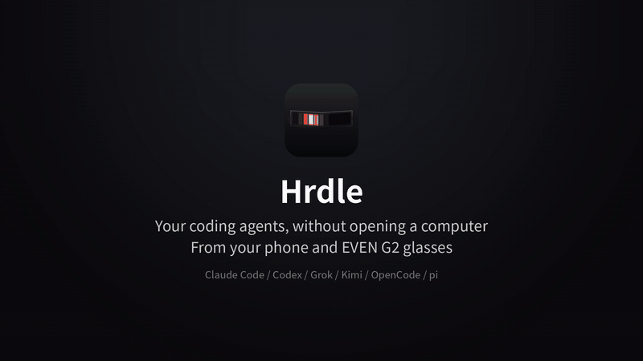
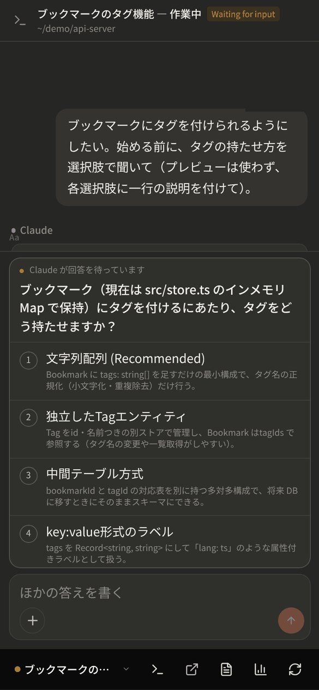
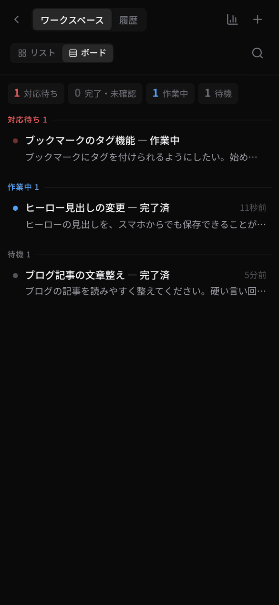
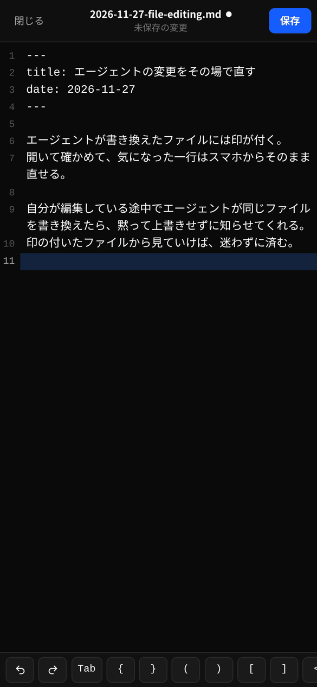
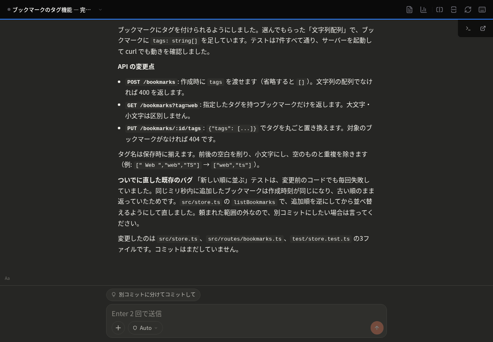
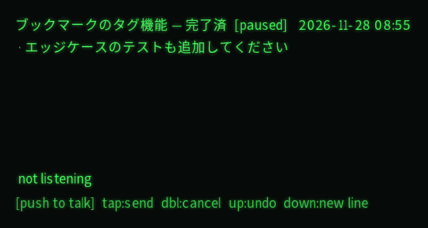

# Hrdle

[日本語](README.ja.md) | English

**Your agents, even away from the desk.**
You are no longer in front of the PC. And still, the work moves on.

Hrdle runs your coding agents — Claude Code, Codex, Grok, Kimi, OpenCode and pi — on a machine
of yours, and puts the controls on your phone and on a pair of EVEN Realities G2 glasses.

**Start work without opening a laptop.** Not just watching — starting. Create a session,
ask by voice, answer its questions from the glasses. The PC stays closed.

The machine can be headless: no display, no keyboard, nobody sitting at it. You reach it
over Tailscale, so the only thing it owes you is staying awake.

*Hrdle = herdr + handle. A handle, held from the G2, for the thing that herds your
sessions. The hurdle of getting started is in the name too.*

## Demo



Full video: [34s](https://github.com/hrdle/hrdle/releases/download/v0.3.238/hrdle-promo-short-en.mp4) · [53s](https://github.com/hrdle/hrdle/releases/download/v0.3.238/hrdle-promo-full-en.mp4) (English) — [34秒](https://github.com/hrdle/hrdle/releases/download/v0.3.238/hrdle-promo-short-ja.mp4) · [53秒](https://github.com/hrdle/hrdle/releases/download/v0.3.238/hrdle-promo-full-ja.mp4) (日本語)

<table>
<tr>
<td align="center"><br><sub>Answer its questions with a tap</sub></td>
<td align="center"><br><sub>See who is waiting on you</sub></td>
<td align="center"><br><sub>Fix a file in place</sub></td>
</tr>
<tr>
<td colspan="2" align="center"><br><sub>The same conversation on a tablet</sub></td>
<td align="center"><br><sub>Reply by voice from the G2</sub></td>
</tr>
</table>

## What it does

- **Start from the phone** — create a session by picking a folder, an agent and the machine, and the agent comes up ready for its first prompt. Nothing has to be open on a computer first.
- **A chat for each agent** — the conversation as a chat, with a composer to write to it: images, slash commands and skills from a palette, the permission mode as a chip, a stop button while it works. Its questions and permission prompts are cards you tap, Claude Code's progress line shows while it works, and its suggested next prompt is one tap away.
- **See who needs you** — a board that groups sessions by what each needs from you: waiting on you, done and unseen, working, idle. Indicators come from the pane itself, with no hooks required.
- **Files** — browse anywhere under your home directory, see which files the agent created or edited, and fix one in place: an edit made while the agent changes the same file is shown, never silently overwritten. Images, video, Markdown, HTML and STL models preview; diffs come from the agent's edits or git.
- **Sessions and panes** — run several agents side by side, split / zoom / resize / close panes, and every connected client sees the same layout. Long-press a session to give it a colour.
- **Made for touch** — tablet split layout with a draggable floating keyboard, a custom mobile keyboard with a pane tab bar, pinch-to-zoom and momentum scrolling. On a desktop the terminal stays in herdr's own client and the browser is for everything around it; it can render the terminal too when you are away from that machine.
- **History and search** — browse and resume past sessions, full-text search across every message, prompt history from all sessions at once.
- **Dashboard** — 5-hour / 7-day usage cycles, time to reset and a projection of when you will hit the limit at the current pace, per-model token use, cost estimates, CPU / memory / swap history, WebSocket latency.
- **Several machines** — peer servers over Tailscale, auto-discovered, with sessions, history and dashboards aggregated. `hrdle send` and `hrdle peek` drive a pane on any of them from the CLI.
- **Unattended** — HTTPS through Tailscale certificates, optional password, and a systemd / launchd service with auto-restart and auto-update.

The UI is English and Japanese, detected automatically.

## Smart glasses (EVEN Realities G2)

A companion app for the G2 (`glasses/`, built with the EvenHub SDK) turns the glasses
into a read-and-answer surface for your sessions — for when the agent needs a decision
and you are not at a screen.

- **Read and answer** — session list with status indicators, conversation view, and a
  choice mode that answers `AskUserQuestion` prompts without touching a keyboard
- **Notifications go to the lenses, not the browser** — while the app is connected, hook
  events become 90-second relay items on the G2 display. If the glasses are absent or the
  session cannot be resolved, the browser notification fires as before, so nothing is lost
- **Voice input** — hold to speak, let go to end the phrase, then send. The G2 SDK emits
  raw PCM, so transcription happens server-side via `POST /api/glasses/stt` (Groq
  `whisper-large-v3-turbo`). **The audio and the API key never leave your host**
- **Agent-written notes** — `hrdle glasses "<text>"` lets an agent put one line in front of
  you, with optional choices to answer. The session is resolved from the working directory,
  so agents rarely need to name it
- **Every machine** — with peers, the list opens on the machines, and their questions and
  notices reach the lenses through the one server the glasses talk to
- **Simulator** — the same app builds for the browser and is served at `/glasses`, so you
  can try it without hardware

Build and distribution live in [`glasses/README.md`](glasses/README.md). The packaged
`out.ehpk` is uploaded to EVEN Hub.

## Requirements

| Dependency | Installation |
|------------|--------------|
| [Tailscale](https://tailscale.com/) | **Install this first.** Linux: `curl -fsSL https://tailscale.com/install.sh \| sh` / macOS: `brew install tailscale` (the App Store build ships no CLI, which certificate generation needs). Then `sudo tailscale set --operator=$USER`, once |
| [herdr](https://herdr.dev/) | The installer installs it if it is missing (`HRDLE_SKIP_HERDR=1` to do it yourself) |
| [Claude Code](https://docs.anthropic.com/en/docs/claude-code) | `npm install -g @anthropic-ai/claude-code`, then sign in once. Codex, Grok Build, Kimi Code, OpenCode and pi work too |

## Install

**Setting it up with the glasses?** [The setup guide](https://hrdle-setup.abe00makoto.workers.dev)
walks through all of it — machine, agent, Tailscale, install, voice key, connect — in about
ten minutes. What follows is the same install, condensed.

With Tailscale already installed, this is the whole of it:

```bash
curl -fsSL https://raw.githubusercontent.com/hrdle/hrdle/main/install.sh | bash
```

It installs herdr if it is missing, allows certificate generation, registers the service,
and finishes by printing the server's address: a short code to type into the glasses
app, and the URL for a browser.

Two things it cannot do for you:

- **`sudo tailscale set --operator=$USER`** — sudo cannot prompt for a password from a
  piped script, so if no cached credential is available the installer prints this line and
  stops short of the service. Run it, then `hrdle setup`.
- **A password.** As installed, anything signed in to your tailnet can open it. To be asked
  for one in the browser, run `hrdle setup -P mypassword`.

Set `HRDLE_NO_SERVICE=1` to install the binary only, or `HRDLE_SKIP_HERDR=1` to install
herdr yourself.

<details>
<summary>Manual installation</summary>

Download the binary for your platform from
[Releases](https://github.com/hrdle/hrdle/releases/latest) — `hrdle-linux-x64` or
`hrdle-macos-arm64` — then put it on your PATH:

```bash
chmod +x hrdle-linux-x64
mv hrdle-linux-x64 ~/bin/hrdle
echo 'export PATH="$HOME/bin:$PATH"' >> ~/.bashrc && source ~/.bashrc
```

</details>

### The service

`hrdle setup` enables auto-start on boot (systemd on Linux, launchd on macOS),
auto-restart on crash, auto-update via `hrdle update`, and a supervised herdr server with
agent conversations resumed on restart.

Sessions live in the herdr server process, so restarting or updating Hrdle never kills
them.

## Commands

```bash
# Server
hrdle                        # Start on port 5924
hrdle -p 8080                # Specify port
hrdle -P mypassword          # Start with password

# Service (auto-restart, auto-update)
hrdle setup -P mypassword
hrdle uninstall              # Remove service registration

# Update
hrdle update                 # Update to latest
hrdle update --check         # Check for updates only
hrdle update --auto          # Auto-update mode (for timer)

hrdle status                 # Service status
hrdle notify                 # Send a hook event (reads JSON from stdin)

# Print this server's address: the short form for the glasses app's Connect
# step, and the URL for a browser. (`hrdle qr` is the old name for it.)
hrdle address

# Remote pane control (target: <peer>:<session>:<paneId>)
hrdle send <target> [text]   # Send input to a pane on a local or peer server
hrdle peek <target>          # Snapshot a pane's current viewport

hrdle debug <sub>            # Bun inspector on the running service
                             # sub: enable | disable | profile | status
```

| Option | Description | Default |
|--------|-------------|---------|
| `-p, --port` | Port number | 5924 |
| `-H, --host` | Bind address | 0.0.0.0 |
| `-P, --password` | Auth password | none |
| `-h, --help` | Show help | - |
| `-v, --version` | Show version | - |

**`hrdle send`** — `<target>` is `<peer>:<session>:<paneId>`, where peer is `local`, a peer id, or a nickname:

| Option | Description |
|--------|-------------|
| `--stdin` | Read payload from stdin instead of the argument |
| `--newline` | Append `\r` to the payload (acts like pressing Enter once) |
| `--submit` | Wrap payload in bracketed paste markers + Enter (Claude Code / Codex TUI submit, works at any length) |
| `--base64` | Treat payload as base64 (binary-safe) |
| `--wait` | After sending, snapshot the pane viewport with detected state (idle / processing / permission_prompt / ask_user_question) |
| `--wait-ms <n>` | Delay before snapshot when `--wait` is set (default 800) |
| `--lines <n>` | Trailing rows to include in the viewport (default 20, also for `hrdle peek`) |

**`hrdle debug`** — `--seconds <n>` (for `profile`: enable for N seconds then auto-disable).

## Keyboard shortcuts

On a desktop with the terminal rendered in the browser:

| Shortcut | Action |
|----------|--------|
| `Ctrl+B` | Session modal |
| `Ctrl+Shift+B` | Toggle dashboard panel |
| `Ctrl+Shift+E` | Split pane (new pane on the right) |
| `Ctrl+Shift+D` | Split pane (new pane below) |
| `Ctrl+Shift+X` | Close pane |
| `Alt+Arrow` | Move focus between panes |
| `Ctrl+Shift+Arrow` | Resize pane |
| `Ctrl+Shift+=` | Equalize pane sizes |
| `Ctrl/Cmd+1`..`9` | Switch session |
| `Ctrl/Cmd+=` / `-` / `0` | Font size up / down / reset |
| `Ctrl/Cmd+C` (with selection) / `Ctrl/Cmd+V` | Copy / paste |

`Ctrl+D`, `Ctrl+W` and `Ctrl+Arrow` go to the pane: they are EOF, delete-word and word
motion in every shell.

## Hook notifications

Browser push notifications when Claude Code finishes a response or needs input. Add
`hrdle notify` to `~/.claude/settings.json`:

```json
{
  "hooks": {
    "Stop": [{ "hooks": [{ "type": "command", "command": "hrdle notify" }] }],
    "PostToolUse": [{
      "matcher": "AskUserQuestion",
      "hooks": [{ "type": "command", "command": "hrdle notify" }]
    }]
  }
}
```

The server must be running, and the browser must be allowed to show notifications on first
access.

Session indicators (working / waiting / done) need no hooks at all — herdr reports agent
status itself. These two carry only what herdr cannot see: the notification text, and the
name of the tool that asked a question.

Hooks run in a **non-interactive** shell, which never sources `.zshrc`/`.bashrc`. If your
PATH additions live there (a `~/bin` or `~/.local/bin` install), the bare name will not
resolve and the hook dies with `command not found`. Use the absolute path from
`which hrdle` in that case — Hrdle's own "set up hooks" button already writes it:

```json
{ "type": "command", "command": "/home/you/bin/hrdle notify" }
```

## herdr backend

Hrdle runs every session as a [herdr](https://herdr.dev/) workspace, and `hrdle setup`
provisions the lot: a supervised `herdr server`, `~/.config/herdr/config.toml` with
`resume_agents_on_restore = true`, and the Claude / Codex integration hooks for native
session identity.

To update herdr later: `herdr update`, then restart the supervised server
(`systemctl --user restart herdr`). The update replaces the binary but leaves the running
server on the old version, so the restart is what applies it — Hrdle notices that gap and
shows a dashboard warning with a button that does both steps. Restarting re-creates every
pane: agent conversations come back automatically, commands running in a pane do not,
which is why it waits for you to press it.

Do **not** use `herdr update --handoff` under systemd/launchd — the handed-off server
escapes supervision.

## Development

[Bun](https://bun.sh/) 1.0+ is required.

```bash
bun install
bun run dev             # Backend + frontend; open http://localhost:5174

bun run dev:frontend    # Frontend only
bun run dev:backend     # Backend only
bun run test            # Run all tests
bun run test:e2e        # E2E tests
bun run lint            # Lint all packages
bun run build:binary    # Single binary at ./dist/hrdle
```

**Stack** — Bun, Hono and WebSocket on the backend; React 19, Vite, Tailwind CSS v4,
xterm.js and react-i18next on the frontend; herdr's socket API plus per-pane control
streams for the terminal.

## Architecture

An interactive overview of backend services, API routes, frontend components, hooks, the
WebSocket protocol, shared types and the major data flows lives in
[`architecture.html`](architecture.html) (data: [`architecture.json`](architecture.json)).

- Render it in your browser via [raw.githack](https://raw.githack.com/hrdle/hrdle/main/architecture.html) — the JSON is embedded, no external fetch required.
- Edit `architecture.json` and run `python3 scripts/build-architecture-html.py` to refresh the embed.

## License

MIT
